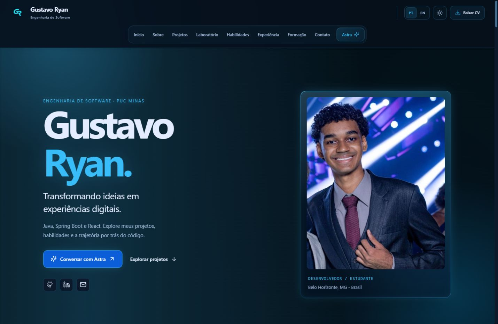
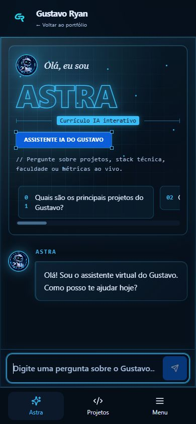
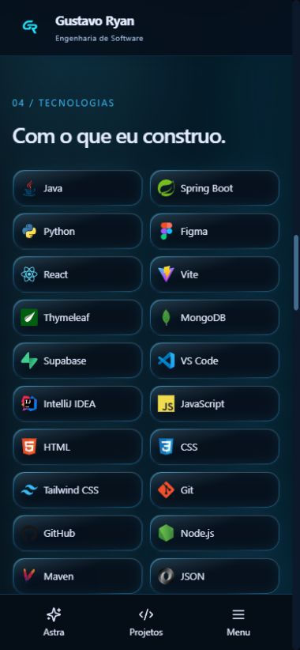
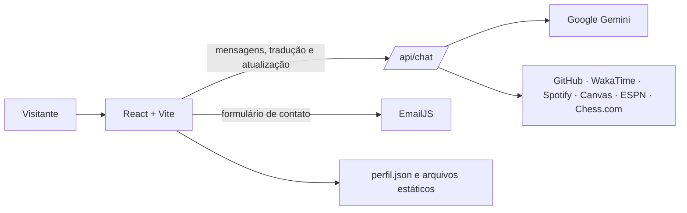

# Portfólio Interativo com IA 👨‍💻

         

---

## 📚 Índice

- [Links úteis](#-links-úteis)
- [Sobre o projeto](#-sobre-o-projeto)
- [Capturas de tela](#-capturas-de-tela)
- [Funcionalidades](#-funcionalidades)
- [Tecnologias](#-tecnologias)
- [Arquitetura](#-arquitetura)
- [Instalação e execução](#-instalação-e-execução)
- [Deploy](#-deploy)
- [Estrutura do projeto](#-estrutura-do-projeto)
- [Testes e build](#-testes-e-build)
- [Documentação](#-documentação)
- [Autor](#-autor)
- [Contribuição](#-contribuição)
- [Licença](#-licença)

---

## 🔗 Links úteis

- 🌐 **Portfólio:** [gustavoryan.vercel.app](https://gustavoryan.vercel.app)
- 💻 **GitHub:** [gustavoryandev](https://github.com/gustavoryandev)
- 💼 **LinkedIn:** [Gustavo Ryan Gomes Guedes](https://linkedin.com/in/gryangomesguedes)
- 📧 **Contato:** [gryangomesguedes@gmail.com](mailto:gryangomesguedes@gmail.com)

## 📝 Sobre o projeto

Portfólio de Gustavo Ryan Gomes Guedes, graduando em Engenharia de Software na PUC Minas. A página inicial (`/`) reúne projetos, tecnologias, experiência, formação e contato. Os atalhos da Astra abrem uma conversa rápida em painel lateral (tela cheia no celular). “Abrir Astra completa” leva a `/chat`, com a mesma conversa, xadrez local e detalhes de GitHub, WakaTime e Chess.com. A bola de habilidades e a proficiência ficam juntas na seção de habilidades do portfólio.

O conteúdo do perfil é mantido em `src/data/perfil.json`. A interface oferece português e inglês, temas claro e escuro e suporte a movimento reduzido.

## 📸 Capturas de tela

**Portfólio no desktop**



**Chat e habilidades no mobile**

<p>
  
  
</p>

## ✨ Funcionalidades

- **Assistente Astra:** perguntas sobre perfil, projetos e trajetória, com histórico contextual e respostas em fluxo. Nas duas interfaces, digite `/help` ou abra Recursos para ver atalhos de navegação, projetos, métricas, tema, idioma e Laboratório.
- **Catálogo de projetos:** busca por texto, filtros por categoria e rolagem horizontal com gestos no celular.
- **Laboratório de código:** exemplos editáveis em desktop e celular. JavaScript e Python rodam no navegador; Java usa Wandbox. Experimente pedir “Abra o Laboratório, selecione Python, carregue Bro Fit e mude o nome do aluno para Ana”. A Astra mostra a alteração para revisão antes de aplicá-la. Rascunhos e resultados ficam em memória enquanto você navega entre o portfólio e as duas interfaces; recarregar a página encerra a sessão.
- **Interface mobile:** navegação inferior para Astra e Projetos, campo de mensagem na base do chat e habilidades em duas colunas. As demais seções ficam no Menu.
- **Cards interativos na conversa:** projetos, habilidades, experiência, currículo, contato e dados de serviços externos aparecem junto às respostas.
- **Integrações ao vivo:** estatísticas do GitHub, linguagens e repositórios; atividade de programação via WakaTime; música atual via Spotify; tarefas acadêmicas do Canvas LMS; agenda do Atlético Mineiro; e perfil/partida de xadrez do Chess.com.
- **Atualização de dados:** os cards indicam quando a fonte está indisponível e permitem tentar novamente quando aplicável.
- **Navegação por seções:** sobre mim, projetos, experiência, educação, habilidades, proficiência e contato.
- **Currículo para download:** arquivos PDF em português e inglês.
- **Contato por formulário:** envio de mensagem e confirmação ao visitante via EmailJS.
- **Português e inglês:** seletor de idioma na interface e suporte a respostas da assistente nos dois idiomas.
- **Temas claro e escuro**, layout responsivo e suporte a preferência por movimento reduzido.

## 🛠 Tecnologias

### Front-end

- React 19 e Vite
- JavaScript (ES modules)
- Tailwind CSS 3
- i18next e react-i18next
- Framer Motion e Lucide React
- Axios
- `chess.js` e `react-chessboard` para a experiência de xadrez

### API e serviços

- Node.js e funções serverless da Vercel
- Google Gemini API para a assistente e tradução de respostas
- GitHub API, WakaTime, Spotify, Canvas LMS, ESPN e Chess.com para dados dos cards
- EmailJS Browser SDK para o formulário de contato

## 🏗 Arquitetura



O front-end envia mensagens, pedidos de tradução e atualização de contexto para `/api/chat`. Em produção, `api/chat.js` funciona como função serverless da Vercel; no desenvolvimento, o plugin de `server/devApi.js` encaminha a mesma rota ao handler local. As credenciais privadas das APIs ficam no servidor. O formulário EmailJS é enviado diretamente do navegador com identificadores públicos próprios do serviço.

## 🚀 Instalação e execução

### Pré-requisitos

- Node.js 22.13 ou superior (requisito do `pdfjs-dist` usado no projeto)
- npm
- Chaves das integrações que deseja habilitar (opcionais para abrir a interface)

### 1. Instale as dependências

```bash
npm install
```

### 2. Configure o ambiente

Copie `.env.example` para `.env.local` e preencha as credenciais necessárias. Deixe vazias as integrações que não for usar.

| Variável | Uso |
| --- | --- |
| `GEMINI_API_KEY` | Respostas e tradução da assistente Astra |
| `GITHUB_USERNAME`, `GITHUB_TOKEN` | Métricas e repositórios do GitHub |
| `WAKATIME_API_KEY` | Métricas de tempo de programação |
| `SPOTIFY_CLIENT_ID`, `SPOTIFY_CLIENT_SECRET`, `SPOTIFY_REFRESH_TOKEN` | Música atual no Spotify |
| `CANVAS_API_TOKEN`, `CANVAS_BASE_URL` | Informações acadêmicas do Canvas LMS |
| `CHESS_USERNAME` | Perfil e dados de xadrez do Chess.com |
| `VITE_EMAILJS_SERVICE_ID`, `VITE_EMAILJS_TEMPLATE_ID_FOR_ME`, `VITE_EMAILJS_TEMPLATE_ID_FOR_SENDER`, `VITE_EMAILJS_PUBLIC_KEY` | Formulário e confirmação de contato |

As variáveis `VITE_` são públicas no bundle do navegador. Não coloque tokens privados nelas. Para detalhes dos templates de contato, consulte [`docs/contact-email.md`](docs/contact-email.md).

### 3. Inicie o servidor de desenvolvimento

```bash
npm run dev
```

Abra a URL local exibida pelo Vite. A configuração do projeto disponibiliza `/api/chat` durante o desenvolvimento. Reinicie o servidor após alterar variáveis de ambiente.

### Build local

```bash
npm run build
npm run preview
```

## ☁️ Deploy

O projeto está configurado para deploy na Vercel: o front-end é construído com Vite e `api/chat.js` atende a rota serverless `/api/chat`. Configure no painel da hospedagem as variáveis privadas das integrações e as variáveis públicas do EmailJS antes do build de produção. `vercel.json` está presente no repositório.

## 📂 Estrutura do projeto

```text
.
├── api/
│   └── chat.js                 # Assistente, tradução e fontes de dados ao vivo
├── docs/                       # Notas das integrações e capturas de tela
├── public/                     # Imagens, ícones e currículos PDF
├── server/
│   ├── devApi.js                # Rota local /api/chat para o Vite
│   └── liveCache.js             # Cache de integrações no servidor
├── src/
│   ├── components/              # Chat, cards e seções do portfólio
│   ├── context/                 # Estado global do tema
│   ├── data/                    # Perfil, projetos e tecnologias
│   ├── hooks/                   # Hooks de contexto ao vivo
│   ├── i18n/                    # Traduções em português e inglês
│   ├── pages/                   # Rotas do portfólio e do chat
│   └── services/                # Cliente da API, contato e contexto ao vivo
├── tests/                       # Testes automatizados existentes
├── .env.example                 # Modelo das variáveis de ambiente
└── vite.config.js               # Vite e middleware local da API
```

## 🧪 Testes e build

Os testes existentes usam o test runner nativo do Node.js. Para executá-los:

```bash
node --test tests/*.test.mjs
```

Para verificar a compilação de produção:

```bash
npm run build
```

## 📖 Documentação

- [Configuração do contato EmailJS](docs/contact-email.md)
- [Catálogo e origem dos projetos do GitHub](docs/github-projects.md)
- [Documentação do React](https://react.dev/)
- [Documentação do Vite](https://vite.dev/)
- [Documentação do Gemini API](https://ai.google.dev/gemini-api/docs)

## 👤 Autor

**Gustavo Ryan Gomes Guedes** — graduando em Engenharia de Software na PUC Minas.

- [GitHub](https://github.com/gustavoryandev)
- [LinkedIn](https://linkedin.com/in/gryangomesguedes)
- [E-mail](mailto:gryangomesguedes@gmail.com)

## 🤝 Contribuição

Sugestões e correções podem ser enviadas por meio de *issues* ou *pull requests* no repositório. Para alterações maiores, descreva primeiro a proposta e o comportamento esperado.

## 📄 Licença

O repositório não contém um arquivo de licença no momento. Consulte o autor antes de redistribuir ou reutilizar o código.

### Reformulação da Astra

O botão flutuante “Perguntar pra Astra”, recuperado do controle `astra-fab` histórico, é o único acionador do modal no portfólio. Cabeçalho, navegação mobile e CTA final abrem `/chat`, passando pela intro original da Astra. A intro do portfólio também foi preservada.

Uma única instância de `ChatPage` mantém mensagens, rascunho, contexto do Gemini e streaming ao fechar/reabrir o modal ou navegar internamente para `/chat`. O histórico fica em memória nesta aba e é reiniciado ao recarregar. O modal usa `dialog.showModal()`, contém Tab/Shift+Tab, fecha com Escape e restaura foco e rolagem. Sua altura acompanha `visualViewport`.

A abertura da página completa reutiliza `AstraHero` e os estilos originais do histórico (`6ba433b`, preservados em `700b12e`): seis sugestões, saudação e campo de mensagem. Recursos aparecem exclusivamente como cards da conversa após pedidos relevantes. Partida (`CHESS_GAME`), rating (`CHESS_CARD`) e proficiência (`SKILLS_CARD`) têm intenções distintas em PT/EN; as métricas mantêm a seleção de fontes existente. O portfólio contém o globo e a lista de tecnologias, sem o painel de proficiência.

O xadrez usa `chess.js` e `react-chessboard`: visitante com brancas, lances locais aleatórios, promoção automática para dama e reinício. As integrações continuam com cache, atualização e indicação de dados indisponíveis.
