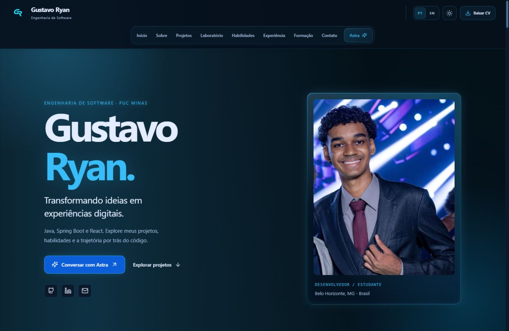
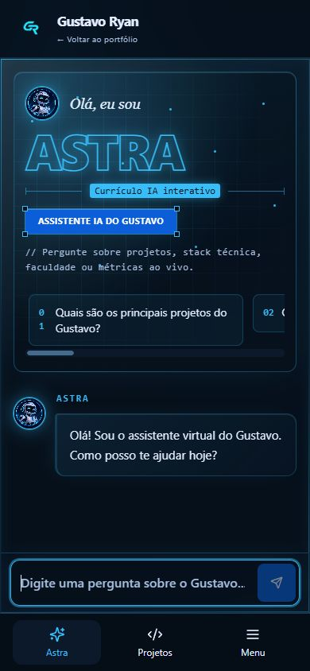
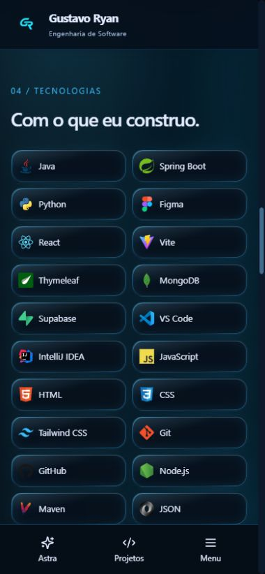

# Portfólio Interativo com IA

**Um portfólio conversacional apresentado pela Astra, em português e inglês.**

[Portfólio](https://gustavoryan.vercel.app) · [GitHub](https://github.com/gustavoryandev) · [LinkedIn](https://linkedin.com/in/gryangomesguedes) · [Contato](mailto:gryangomesguedes@gmail.com)

---

## Sobre o projeto

O portfólio de Gustavo Ryan Gomes Guedes combina páginas interativas e uma conversa com a Astra. A rota / apresenta projetos, experiência, formação, habilidades e contato. A Astra compacta abre no portfólio; /chat oferece a experiência completa, com acesso ao Laboratório, Arcade, xadrez e cards de integrações.

As respostas podem usar Gemini quando configurado. Sem a chave, funções determinísticas e recursos locais continuam disponíveis; perguntas que dependem da geração por IA informam a indisponibilidade.

## Funcionalidades

### Astra e cards

A conversa funciona em português e inglês, com respostas JSON ou streaming NDJSON, tradução sob demanda e contexto de conversas anteriores. O prompt trata biografias, READMEs e descrições de terceiros como dados, não como instruções. Perguntas selecionadas sobre métricas são atendidas diretamente pelas integrações.

| Marcador | Conteúdo |
|---|---|
| <code>[RESUME_CARD]</code> | Currículo PDF |
| <code>[PROJECTS_CARD]</code>, <code>[EXPERIENCE_CARD]</code>, <code>[SKILLS_CARD]</code> | Projetos, experiência e habilidades |
| <code>[GITHUB_CARD]</code>, <code>[GITHUB_ACTIVITY_CARD]</code>, <code>[GITHUB_LANGUAGES_CARD]</code>, <code>[REPOSITORIES_CARD]</code> | Estatísticas, atividade, linguagens e repositórios do GitHub |
| <code>[STATS_CARD]</code>, <code>[WAKATIME_CARD]</code> | Métricas de programação do WakaTime |
| <code>[SPOTIFY_CARD]</code>, <code>[CANVAS_CARD]</code>, <code>[GALO_CARD]</code>, <code>[GALO_CARD:N]</code>, <code>[GALO_CARD:ALL]</code> | Spotify, matérias no Canvas LMS e jogos do Atlético Mineiro |
| <code>[CHESS_CARD]</code>, <code>[CHESS_GAME]</code>, <code>[CHESS_REPLAY]</code> | Perfil e partidas de xadrez, tabuleiro e replay |
| <code>[CONTACT_FORM]</code> | Formulário de contato |

Os dados externos incluem GitHub, WakaTime, Spotify, Canvas LMS, ESPN e Chess.com. O cache é separado por fonte; falhas podem manter o último dado válido visível e indicar que está desatualizado.

### Temas, dimensões e personas

O seletor reúne temas claros, escuros e paletas do Galo, além das experiências temáticas integradas nesta release:

- **Rick and Morty:** Garage, Citadel e a dimensão secreta Beyond. Personas: Meeseeks e Pessoa-Pássaro na Garage; Meeseeks e Sr. Bunda Cagada na Citadel; Rick Maligno e Evil Morty em Beyond. As travessias respeitam movimento reduzido e têm fallback.
- **La Casa de Papel:** tema escuro **O Assalto** e claro **O Plano**, com Berlim na Astra compacta, Professor na completa e o efeito interativo de máscara no retrato.
- A Astra compacta e a completa compartilham contexto e ações, mantendo a persona correspondente ao tema e à dimensão.

O preview de áudio de Beyond usa evil-morty-30s.mp3 somente em desenvolvimento; o código o desabilita em builds de produção enquanto a distribuição não estiver confirmada.

### Laboratório, jogos e xadrez

O Laboratório permite experimentar exemplos de código e revisar alterações antes de aplicá-las. O Arcade inclui Snake, Pong, Frogger, Pulse Maze e Orbit Blocks, com recordes locais. A experiência de xadrez permite importar partidas, analisar lances e jogar contra um bot local; a análise usa Stockfish em Web Worker.

### Contato

O formulário envia notificações e confirmações pelo handler serverless /api/contact, com verificação reCAPTCHA e envio ao EmailJS no servidor. Há validação, limites de envio e proteção contra reenvio incerto.

### Interface e acessibilidade

A interface é responsiva, bilíngue e respeita a preferência por movimento reduzido. Os componentes incluem controles por teclado, estados de carregamento e falha e alternativas para mídias indisponíveis.

## Stack

| Camada | Tecnologias |
|---|---|
| Interface | React 19, Vite 6, Tailwind CSS 3, i18next |
| API | Node.js, funções serverless da Vercel e handlers locais do Vite |
| IA | Google Gemini, opcional por configuração |
| Integrações | GitHub, WakaTime, Spotify, Canvas LMS, ESPN e Chess.com |
| Xadrez e mídia | chess.js, react-chessboard, Stockfish, pdf.js |
| Contato | reCAPTCHA e EmailJS via servidor |

## Arquitetura

    Navegador (React)
       ├─ POST /api/chat ───────> Astra, métricas e contexto de integrações
       ├─ POST /api/contact ────> reCAPTCHA e envio de e-mail
       └─ páginas e assets locais
                  │
                  ▼
          handlers serverless
          api/chat.js · api/contact.js

Em produção, a Vercel atende as rotas API e serve a aplicação. No desenvolvimento, o plugin em server/devApi.js encaminha /api/chat e /api/contact aos mesmos handlers. O arquivo vercel.json direciona /chat à aplicação React.

## Capturas de tela

**Portfólio no desktop**

**Astra e habilidades no mobile**

  
  

## Como executar localmente

### Requisitos

- Node.js 22.13 ou superior, exigido pela versão de pdfjs-dist no lockfile.
- npm.

### Instalação

    git clone https://github.com/gustavoryan-del/Portfolio-Profissional-Interativo.git
    cd Portfolio-Profissional-Interativo
    npm ci
    cp .env.example .env.local

Preencha apenas as integrações que deseja habilitar. Nunca versione .env.local.

### Servidores de desenvolvimento

    npm run dev

O Vite inclui handlers locais para as rotas de chat e contato.

    npx vercel dev

Use vercel dev para testar as funções serverless no ambiente local da Vercel. Ambos os servidores exibem o endereço local no terminal.

### Build e preview

    npm run build
    npm run preview

## Variáveis de ambiente

.env.example lista as configurações suportadas. Sem GEMINI_API_KEY, a geração livre fica indisponível, mas respostas determinísticas e recursos locais continuam funcionando. Integrações sem credenciais exibem seu estado de indisponibilidade.

| Variáveis | Uso |
|---|---|
| GEMINI_API_KEY | Geração de respostas e tradução pela Gemini API |
| GITHUB_USERNAME, GITHUB_TOKEN | Métricas, repositórios e atividade; o token melhora os limites de consulta |
| WAKATIME_ACCESS_TOKEN, WAKATIME_USERNAME | Métricas via OAuth ou perfil público |
| WAKATIME_APP_ID, WAKATIME_APP_SECRET, WAKATIME_REFRESH_TOKEN, WAKATIME_REDIRECT_URI | Autorização e renovação OAuth do WakaTime |
| WAKATIME_TIMEZONE, WAKATIME_PUBLIC_PROJECTS, WAKATIME_HIDDEN_DEPENDENCIES | Fuso, projetos que podem aparecer e dependências omitidas |
| SPOTIFY_CLIENT_ID, SPOTIFY_CLIENT_SECRET, SPOTIFY_REFRESH_TOKEN | Integração Spotify |
| CANVAS_API_TOKEN, CANVAS_BASE_URL | Integração Canvas LMS |
| CHESS_USERNAME | Perfil do Chess.com; há um padrão no código |
| VITE_RECAPTCHA_SITE_KEY | Chave pública reCAPTCHA v3 usada no navegador |
| RECAPTCHA_SECRET_KEY, RECAPTCHA_MIN_SCORE, RECAPTCHA_ALLOWED_HOSTNAMES | Verificação reCAPTCHA no servidor |
| EMAILJS_SERVICE_ID, EMAILJS_TEMPLATE_ID_FOR_ME, EMAILJS_TEMPLATE_ID_FOR_SENDER, EMAILJS_PUBLIC_KEY, EMAILJS_PRIVATE_KEY | Envio server-side pelo EmailJS |

### OAuth do WakaTime

Cadastre http://localhost:8787/callback no aplicativo OAuth do WakaTime, configure WAKATIME_APP_ID e WAKATIME_APP_SECRET no .env.local e execute:

    npm run wakatime:oauth

O fluxo local recebe o callback e fornece os tokens para configuração. Mantenha tokens e segredos apenas em arquivos locais ignorados ou nas variáveis da hospedagem. WAKATIME_PUBLIC_PROJECTS controla os nomes de projetos públicos; outros aparecem como privados. WAKATIME_HIDDEN_DEPENDENCIES aceita nomes ou prefixos com *.

## Segurança, arquivos locais e mídia

- Guarde tokens e segredos em .env.local durante o desenvolvimento e nas configurações privadas da hospedagem.
- Variáveis com prefixo VITE_ são incorporadas ao código entregue ao navegador. Não use esse prefixo para segredos.
- O conteúdo de public/ é copiado para o build e pode ser publicado. Não coloque ali arquivos privados ou sem autorização de distribuição.
- O .gitignore não retira do índice um arquivo já rastreado. Antes de preparar um commit, confira os arquivos e as regras aplicáveis:

    git check-ignore -v -- .env.local
    git ls-files -- .env.local
    git diff --cached --name-only

As licenças de terceiros estão registradas em [THIRD_PARTY_NOTICES.txt](public/THIRD_PARTY_NOTICES.txt). A presença de uma mídia no repositório não concede, por si só, direitos adicionais de redistribuição.

## Deploy na Vercel

1. Importe o repositório na Vercel.
2. Configure as variáveis necessárias em **Settings → Environment Variables**, mantendo segredos como variáveis server-side.
3. Faça o deploy. A aplicação é servida como conteúdo estático e as rotas API usam funções serverless.

vercel.json encaminha /chat para index.html e configura a duração máxima de api/chat.js. O formulário de contato depende também das variáveis de reCAPTCHA e EmailJS.

## Testes e typecheck

O package.json não define um script npm test. Execute as suítes existentes diretamente:

    node --test tests/*.test.mjs
    node --test tests/isolated/*.test.mjs
    node node_modules/typescript/bin/tsc --noEmit -p tsconfig.portal.json
    npm run build

## Documentação

- [Astra Arcade e recordes locais](docs/astra-arcade.md)
- [Configuração do contato](docs/contact-email.md)
- [Catálogo de projetos e dados GitHub](docs/github-projects.md)
- [Experiência Rick and Morty](docs/rick-morty-experience.md)
- [Fontes e preparação dos assets Rick](docs/rick-morty-assets.md)
- [La Casa de Papel — O Assalto e O Plano](docs/MONEY_HEIST_SPEC.md)
- [Avisos de terceiros](public/THIRD_PARTY_NOTICES.txt)

## Resumo em inglês

An interactive portfolio presented through Astra, a bilingual AI assistant with local deterministic features and optional Gemini generation. It includes project, résumé, skills and live-data cards; a code Laboratory; an Arcade; chess analysis with local Stockfish; and responsive portfolio pages. Themes include Rick and Morty with Garage, Citadel and the secret Beyond dimension, plus La Casa de Papel’s dark Heist and light Plan variants with Berlin and the Professor personas. Serverless routes handle chat and contact; local Vite middleware supports development. See .env.example for configuration and the documentation links above for details.

## Autor

**Gustavo Ryan Gomes Guedes** — Engenharia de Software · PUC Minas · Belo Horizonte, MG.

[GitHub](https://github.com/gustavoryandev) · [LinkedIn](https://linkedin.com/in/gryangomesguedes) · [E-mail](mailto:gryangomesguedes@gmail.com)

## Licença e avisos

Consulte o autor antes de redistribuir ou reutilizar o código. Não foi declarada uma licença geral do projeto. Licenças e créditos de terceiros estão nos [avisos do projeto](public/THIRD_PARTY_NOTICES.txt).

## Contribuição

Sugestões e correções podem ser enviadas por issues ou pull requests. Para mudanças maiores, descreva antes o comportamento esperado.
